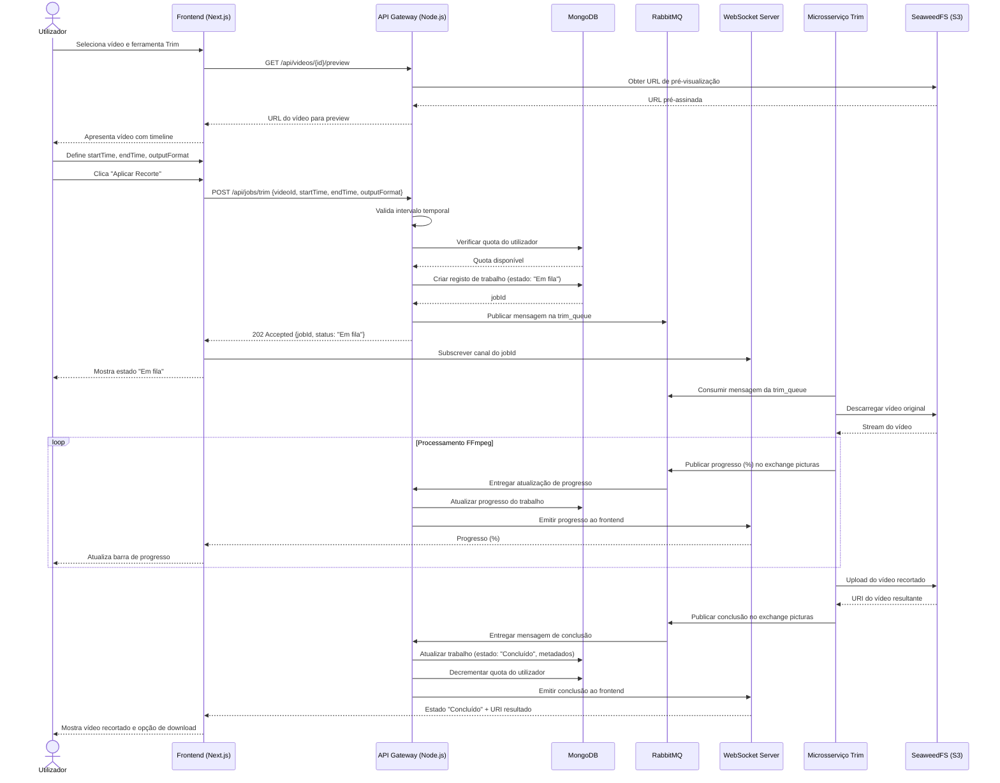
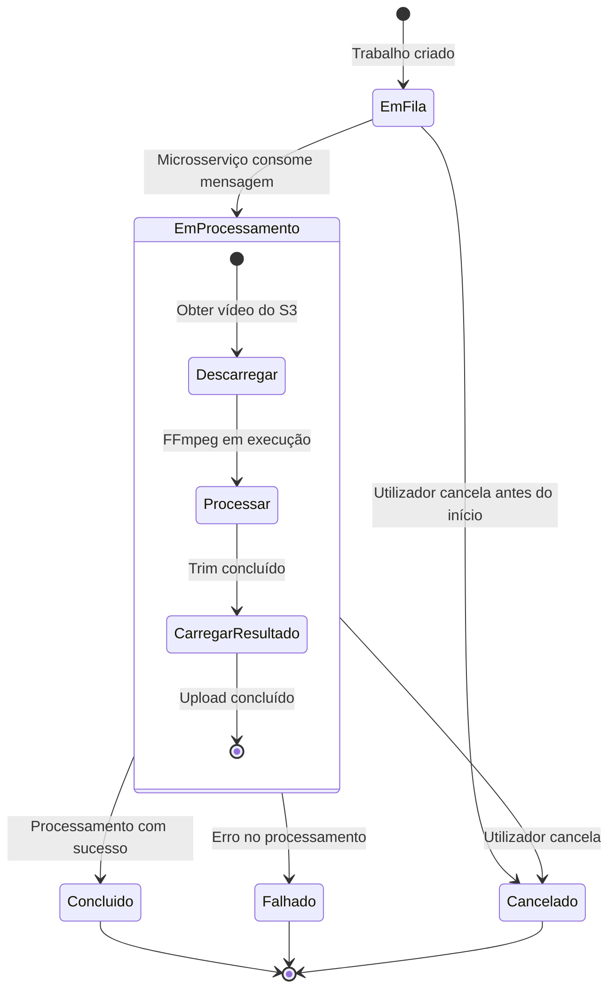

# UC-VID-002 — Recorte Temporal de Vídeo (Trim)

| **Campo**            | **Valor**                                                                 |
|----------------------|---------------------------------------------------------------------------|
| **Identificador**    | UC-VID-002                                                                |
| **Nome**             | Recorte Temporal de Vídeo (Trim)                                          |
| **Módulo**           | Processamento de Vídeo                                                    |
| **Prioridade**       | Alta                                                                      |
| **Complexidade**     | Complexa                                                                  |
| **Autores**          | Alice Soares (PG12345); João Silva (PG12346); Maria Costa (PG12347); Pedro Santos (PG12348); Ana Oliveira (PG12349) |
| **Grupo**            | 27                                                                        |
| **Data**             | 2026-10-14                                                                |
| **Versão**           | 1.0                                                                       |

---

## 0. Sumário Executivo

O presente caso de uso descreve a funcionalidade de **Recorte Temporal de Vídeo (Trim)** na plataforma PictuRAS. Esta operação permite ao utilizador selecionar um instante inicial e um instante final num vídeo, extraindo apenas o segmento temporal compreendido entre ambos. Trata-se de uma das operações mais fundamentais de edição de vídeo e constitui uma peça central do MVP da Fase 1 de extensão da plataforma para suporte a vídeo.

O processamento é **assíncrono**: após a submissão, o trabalho é colocado numa fila RabbitMQ dedicada (`trim_queue`), processado por um microsserviço independente baseado em FFmpeg, e o progresso é comunicado em tempo real ao cliente via WebSocket. O utilizador pode acompanhar os estados do trabalho — *Em fila*, *Em processamento*, *Concluído* ou *Falhado* — e, se necessário, cancelar a operação a meio. A funcionalidade integra-se na pipeline de encadeamento de ferramentas (tool chaining) e respeita o sistema de quotas e perfis de utilizador existente.

---

## 1. Descrição do Caso de Uso

### 1.1 Objetivo

Permitir que um utilizador registado (gratuito ou premium) selecione um segmento temporal de um vídeo — definindo um tempo de início e um tempo de fim — e obtenha um novo ficheiro de vídeo contendo exclusivamente esse segmento, preservando a qualidade original e a faixa de áudio.

### 1.2 Âmbito

Este caso de uso abrange:

- A interação do utilizador com a interface de recorte temporal (timeline e campos de entrada);
- A validação dos parâmetros de recorte (intervalo temporal, formato de saída);
- A criação e gestão assíncrona do trabalho de processamento;
- A comunicação em tempo real do estado e progresso via WebSocket;
- O armazenamento do resultado no SeaweedFS (S3);
- O cancelamento de processamento a meio;
- O encadeamento com outras ferramentas na pipeline;
- A verificação de quotas e perfis de utilizador.

### 1.3 Atores

| **Ator**                  | **Tipo**    | **Descrição**                                                                                      |
|---------------------------|-------------|----------------------------------------------------------------------------------------------------|
| Utilizador Registado      | Primário    | Utilizador com conta ativa (gratuito ou premium) que pretende recortar um vídeo temporalmente.      |
| Utilizador Premium        | Primário    | Subconjunto do utilizador registado, sem limite de operações diárias.                               |
| Microsserviço de Trim     | Sistema     | Microsserviço que consome mensagens da `trim_queue` e executa o recorte via FFmpeg.                 |
| API Gateway               | Sistema     | Ponto de entrada Node.js que recebe pedidos, valida autenticação/autorização e encaminha mensagens.  |
| RabbitMQ                  | Sistema     | Message broker que gere a fila de trabalhos (`trim_queue`) e o exchange `picturas`.                 |
| SeaweedFS (S3)            | Sistema     | Sistema de armazenamento distribuído onde os vídeos originais e resultantes são guardados.           |
| WebSocket Server          | Sistema     | Componente que notifica o frontend em tempo real sobre o progresso e estado do processamento.        |

### 1.4 Pré-condições

| **ID**  | **Pré-condição**                                                                                          |
|---------|-----------------------------------------------------------------------------------------------------------|
| PC-01   | O utilizador está autenticado na plataforma com perfil registado (gratuito) ou premium.                    |
| PC-02   | O utilizador possui pelo menos um projeto com um ou mais vídeos carregados.                                |
| PC-03   | O vídeo original está armazenado e acessível no SeaweedFS.                                                 |
| PC-04   | O formato/codec do vídeo é suportado pelo microsserviço de trim (e.g., MP4/H.264, WebM/VP9, MOV/H.265).   |
| PC-05   | O utilizador não excedeu a quota diária de operações (aplicável a utilizadores gratuitos).                  |
| PC-06   | A ligação WebSocket entre o frontend e o servidor está ativa.                                              |

### 1.5 Pós-condições

#### 1.5.1 Pós-condições de Sucesso

| **ID**  | **Pós-condição**                                                                                           |
|---------|------------------------------------------------------------------------------------------------------------|
| PS-01   | O vídeo recortado está armazenado no SeaweedFS com um novo URI único.                                       |
| PS-02   | O vídeo original permanece intacto e inalterado.                                                            |
| PS-03   | O estado do trabalho é atualizado para **Concluído** no sistema.                                            |
| PS-04   | A quota do utilizador é decrementada em 1 operação (se utilizador gratuito).                                |
| PS-05   | O vídeo resultante aparece na biblioteca do projeto do utilizador.                                          |
| PS-06   | Os metadados do vídeo resultante (duração, tamanho, formato) estão registados na base de dados MongoDB.     |

#### 1.5.2 Pós-condições Mínimas (Falha Controlada)

| **ID**  | **PM-01**                                                                                                  |
|---------|------------------------------------------------------------------------------------------------------------|
| PM-01   | O vídeo original permanece intacto e acessível.                                                             |
| PM-02   | Nenhum ficheiro parcial ou corrompido é acessível ao utilizador.                                            |
| PM-03   | O estado do trabalho é atualizado para **Falhado** com mensagem de erro descritiva.                         |
| PM-04   | A quota do utilizador **não** é decrementada.                                                               |
| PM-05   | Ficheiros temporários de processamento são limpos do sistema de armazenamento.                              |

---

## 2. Fluxos

### 2.1 Fluxo Principal (FP) — Recorte Temporal com Sucesso

| **Passo** | **Ator/Sistema** | **Ação**                                                                                                                                |
|-----------|-------------------|-----------------------------------------------------------------------------------------------------------------------------------------|
| 1         | Utilizador        | Abre a biblioteca de vídeos dentro de um projeto existente.                                                                             |
| 2         | Sistema           | Apresenta a lista de vídeos do projeto com miniaturas, durações e estados.                                                              |
| 3         | Utilizador        | Seleciona um vídeo e escolhe a ferramenta **"Recorte Temporal (Trim)"** no painel de ferramentas.                                        |
| 4         | Sistema           | Carrega uma pré-visualização do vídeo com uma timeline interativa e campos de entrada para tempo de início e tempo de fim.               |
| 5         | Utilizador        | Define o **tempo de início** (formato HH:MM:SS.ms) e o **tempo de fim**, arrastando marcadores na timeline ou preenchendo os campos.     |
| 6         | Utilizador        | Opcionalmente, seleciona o **formato de saída** (igual ao original, MP4 ou WebM). Por omissão, mantém o formato original.                |
| 7         | Utilizador        | Confirma a operação de recorte temporal clicando em **"Aplicar Recorte"**.                                                               |
| 8         | Sistema           | Valida o intervalo temporal: verifica que `tempo_inicio < tempo_fim`, que ambos estão dentro da duração do vídeo, e que a duração do segmento é ≥ 1 segundo. |
| 9         | Sistema           | Verifica a quota do utilizador (se gratuito, confirma que não excedeu 5 operações/dia).                                                  |
| 10        | Sistema           | Cria um registo de trabalho (job) na base de dados MongoDB com estado **"Em fila"** e gera um `jobId` único.                             |
| 11        | Sistema           | Publica uma mensagem JSON na `trim_queue` do RabbitMQ com a estrutura: `{ procedure: "trim", inputVideoURI, outputVideoURI, parameters: { startTime, endTime, outputFormat } }`. |
| 12        | Sistema           | Notifica o frontend via WebSocket com o `jobId` e estado **"Em fila"**.                                                                  |
| 13        | Utilizador        | Visualiza o indicador de estado **"Em fila"** na interface.                                                                              |
| 14        | Microsserviço     | Consome a mensagem da `trim_queue`, descarrega o vídeo original do SeaweedFS e inicia o processamento com FFmpeg.                        |
| 15        | Microsserviço     | Publica atualizações de progresso (percentagem) no exchange `picturas` → `project_queue`.                                                |
| 16        | Sistema           | Recebe as atualizações de progresso e encaminha-as para o frontend via WebSocket. O estado passa a **"Em processamento"** com barra de progresso. |
| 17        | Utilizador        | Acompanha o progresso do processamento em tempo real na interface.                                                                       |
| 18        | Microsserviço     | Conclui o recorte. Faz upload do vídeo resultante para o SeaweedFS e publica mensagem de conclusão no exchange `picturas` → `project_queue` com o `outputVideoURI` e metadados. |
| 19        | Sistema           | Recebe a mensagem de conclusão, atualiza o registo do trabalho para **"Concluído"**, guarda os metadados do vídeo resultante na MongoDB.  |
| 20        | Sistema           | Decrementa a quota do utilizador (se gratuito) e notifica o frontend via WebSocket com estado **"Concluído"**.                            |
| 21        | Utilizador        | Visualiza o estado **"Concluído"**, pré-visualiza o vídeo recortado no reprodutor integrado e pode descarregá-lo.                        |

### 2.2 Fluxos Alternativos

#### FA-01: Cancelamento de processamento a meio

| **Passo** | **Ator/Sistema** | **Ação**                                                                                                              |
|-----------|-------------------|-----------------------------------------------------------------------------------------------------------------------|
| FA-01.1   | Utilizador        | Durante o estado "Em processamento" (passo 17 do FP), clica no botão **"Cancelar"** associado ao trabalho.             |
| FA-01.2   | Sistema           | Envia um sinal de cancelamento ao microsserviço de trim através de uma mensagem na fila de controlo (`trim_control_queue`). |
| FA-01.3   | Microsserviço     | Recebe o sinal de cancelamento, interrompe o processo FFmpeg em execução e elimina ficheiros temporários.               |
| FA-01.4   | Microsserviço     | Publica mensagem de cancelamento confirmado no exchange `picturas` → `project_queue`.                                  |
| FA-01.5   | Sistema           | Atualiza o estado do trabalho para **"Cancelado"**, remove ficheiros parciais do SeaweedFS (se existirem).              |
| FA-01.6   | Sistema           | Notifica o frontend via WebSocket. A quota do utilizador **não** é decrementada.                                        |
| FA-01.7   | Utilizador        | Visualiza o estado **"Cancelado"** e pode reiniciar a operação com os mesmos ou novos parâmetros.                       |

#### FA-02: Recorte de múltiplos segmentos

| **Passo** | **Ator/Sistema** | **Ação**                                                                                                              |
|-----------|-------------------|-----------------------------------------------------------------------------------------------------------------------|
| FA-02.1   | Utilizador        | Após definir o primeiro segmento (passo 5 do FP), clica em **"Adicionar segmento"**.                                   |
| FA-02.2   | Sistema           | Apresenta campos adicionais para definir um segundo intervalo temporal no mesmo vídeo.                                  |
| FA-02.3   | Utilizador        | Define os intervalos de todos os segmentos pretendidos e confirma.                                                      |
| FA-02.4   | Sistema           | Valida todos os intervalos individualmente (mesmas regras do passo 8 do FP). Verifica que a quota permite N operações.  |
| FA-02.5   | Sistema           | Cria N trabalhos sequenciais na `trim_queue`, cada um com o respetivo intervalo temporal.                               |
| FA-02.6   | Sistema           | Processa cada segmento sequencialmente, notificando o progresso de cada um via WebSocket.                               |
| FA-02.7   | Utilizador        | Visualiza o progresso agregado e individual de cada segmento na interface.                                              |

#### FA-03: Recorte como parte de um encadeamento de ferramentas (Tool Chain)

| **Passo** | **Ator/Sistema** | **Ação**                                                                                                              |
|-----------|-------------------|-----------------------------------------------------------------------------------------------------------------------|
| FA-03.1   | Utilizador        | Na interface de pipeline, adiciona a ferramenta **"Recorte Temporal"** seguida de outra ferramenta (e.g., "Ajuste de Brilho"). |
| FA-03.2   | Sistema           | Regista a cadeia de operações (pipeline) associada ao projeto.                                                          |
| FA-03.3   | Utilizador        | Configura os parâmetros de cada ferramenta na sequência e confirma a execução da pipeline.                              |
| FA-03.4   | Sistema           | Cria o primeiro trabalho (trim) e publica na `trim_queue`. O `outputVideoURI` do trim será o `inputVideoURI` da operação seguinte. |
| FA-03.5   | Microsserviço     | Executa o recorte e publica o resultado.                                                                                |
| FA-03.6   | Sistema           | Ao receber a conclusão do trim, cria automaticamente o trabalho seguinte na fila da próxima ferramenta.                 |
| FA-03.7   | Sistema           | Repete o processo até todas as operações da cadeia estarem concluídas, notificando o progresso global via WebSocket.     |

#### FA-04: Ajuste de parâmetros durante pré-visualização

| **Passo** | **Ator/Sistema** | **Ação**                                                                                                              |
|-----------|-------------------|-----------------------------------------------------------------------------------------------------------------------|
| FA-04.1   | Utilizador        | Durante o passo 5 do FP, ajusta os marcadores da timeline enquanto pré-visualiza o vídeo no reprodutor.                |
| FA-04.2   | Sistema           | Atualiza a pré-visualização em tempo real: salta para o tempo de início selecionado e reproduz até ao tempo de fim.     |
| FA-04.3   | Utilizador        | Utiliza os controlos de reprodução (play/pause) para validar visualmente o segmento antes de confirmar.                 |
| FA-04.4   | Utilizador        | Após satisfeito com a seleção, prossegue para o passo 7 do FP.                                                         |

### 2.3 Fluxos de Exceção

#### FE-01: Intervalo temporal inválido (início ≥ fim)

| **Passo** | **Ator/Sistema** | **Ação**                                                                                                              |
|-----------|-------------------|-----------------------------------------------------------------------------------------------------------------------|
| FE-01.1   | Sistema           | No passo 8 do FP, deteta que `tempo_inicio ≥ tempo_fim`.                                                               |
| FE-01.2   | Sistema           | Apresenta mensagem de erro: *"O tempo de início deve ser anterior ao tempo de fim."*                                    |
| FE-01.3   | Utilizador        | Corrige os valores e retorna ao passo 5 do FP.                                                                         |

#### FE-02: Tempo de início ou fim excede a duração do vídeo

| **Passo** | **Ator/Sistema** | **Ação**                                                                                                              |
|-----------|-------------------|-----------------------------------------------------------------------------------------------------------------------|
| FE-02.1   | Sistema           | No passo 8 do FP, deteta que o tempo de início ou de fim ultrapassa a duração total do vídeo.                           |
| FE-02.2   | Sistema           | Apresenta mensagem de erro: *"Os tempos definidos excedem a duração do vídeo (DD:HH:MM:SS)."*                           |
| FE-02.3   | Utilizador        | Corrige os valores e retorna ao passo 5 do FP.                                                                         |

#### FE-03: Duração do segmento inferior a 1 segundo

| **Passo** | **Ator/Sistema** | **Ação**                                                                                                              |
|-----------|-------------------|-----------------------------------------------------------------------------------------------------------------------|
| FE-03.1   | Sistema           | No passo 8 do FP, deteta que `(tempo_fim - tempo_inicio) < 1 segundo`.                                                 |
| FE-03.2   | Sistema           | Apresenta mensagem de erro: *"A duração mínima do segmento de recorte é de 1 segundo."*                                |
| FE-03.3   | Utilizador        | Ajusta o intervalo e retorna ao passo 5 do FP.                                                                         |

#### FE-04: Formato/codec de vídeo não suportado

| **Passo** | **Ator/Sistema** | **Ação**                                                                                                              |
|-----------|-------------------|-----------------------------------------------------------------------------------------------------------------------|
| FE-04.1   | Sistema           | No passo 4 do FP, ao carregar o vídeo, deteta que o formato ou codec não é suportado pelo microsserviço de trim.        |
| FE-04.2   | Sistema           | Apresenta mensagem de erro: *"O formato do vídeo selecionado não é suportado para recorte temporal. Formatos suportados: MP4, WebM, MOV."* |
| FE-04.3   | Utilizador        | Seleciona um vídeo diferente ou converte o vídeo para um formato suportado antes de prosseguir.                         |

#### FE-05: Falha de processamento (erro FFmpeg)

| **Passo** | **Ator/Sistema** | **Ação**                                                                                                              |
|-----------|-------------------|-----------------------------------------------------------------------------------------------------------------------|
| FE-05.1   | Microsserviço     | Durante o processamento (passo 14 do FP), o FFmpeg reporta um erro (e.g., ficheiro corrompido, codec inválido).        |
| FE-05.2   | Microsserviço     | Publica mensagem de falha no exchange `picturas` → `project_queue` com o código de erro e descrição.                    |
| FE-05.3   | Sistema           | Atualiza o estado do trabalho para **"Falhado"**, elimina ficheiros temporários e notifica o frontend via WebSocket.     |
| FE-05.4   | Sistema           | A quota do utilizador **não** é decrementada.                                                                           |
| FE-05.5   | Utilizador        | Visualiza a mensagem de erro e pode tentar novamente ou contactar o suporte.                                            |

#### FE-06: Quota diária excedida

| **Passo** | **Ator/Sistema** | **Ação**                                                                                                              |
|-----------|-------------------|-----------------------------------------------------------------------------------------------------------------------|
| FE-06.1   | Sistema           | No passo 9 do FP, deteta que o utilizador gratuito já atingiu o limite de 5 operações/dia.                              |
| FE-06.2   | Sistema           | Apresenta mensagem: *"Limite diário de operações atingido. Atualize para Premium para operações ilimitadas."*           |
| FE-06.3   | Utilizador        | Pode aguardar pelo dia seguinte ou subscrever o plano Premium.                                                          |

#### FE-07: Armazenamento insuficiente para o resultado

| **Passo** | **Ator/Sistema** | **Ação**                                                                                                              |
|-----------|-------------------|-----------------------------------------------------------------------------------------------------------------------|
| FE-07.1   | Microsserviço     | Após concluir o recorte, falha ao fazer upload do resultado para o SeaweedFS por falta de espaço.                       |
| FE-07.2   | Microsserviço     | Publica mensagem de falha no exchange `picturas` → `project_queue`.                                                     |
| FE-07.3   | Sistema           | Atualiza o estado para **"Falhado"** com mensagem: *"Espaço de armazenamento insuficiente."* A quota não é decrementada. |
| FE-07.4   | Utilizador        | Visualiza o erro e pode libertar espaço eliminando ficheiros ou contactar o suporte.                                    |

#### FE-08: Vídeo original inacessível

| **Passo** | **Ator/Sistema** | **Ação**                                                                                                              |
|-----------|-------------------|-----------------------------------------------------------------------------------------------------------------------|
| FE-08.1   | Microsserviço     | No passo 14 do FP, ao tentar descarregar o vídeo original do SeaweedFS, falha (ficheiro não encontrado ou inacessível). |
| FE-08.2   | Microsserviço     | Publica mensagem de falha no exchange `picturas` → `project_queue`.                                                     |
| FE-08.3   | Sistema           | Atualiza o estado para **"Falhado"** com mensagem: *"O vídeo original não se encontra acessível."*                      |
| FE-08.4   | Utilizador        | Visualiza o erro e pode tentar recarregar o vídeo ou contactar o suporte.                                               |

---

## 3. Informação Complementar

### 3.1 Regras de Negócio

| **ID** | **Regra**                                                                                                                     |
|--------|-------------------------------------------------------------------------------------------------------------------------------|
| RN-01  | A duração mínima do segmento de recorte é de **1 segundo**.                                                                   |
| RN-02  | O recorte **preserva o codec e a qualidade originais** do vídeo, exceto se o utilizador especificar um formato de saída diferente. |
| RN-03  | Cada operação de recorte temporal conta como **1 operação** para efeitos de quota, independentemente da duração do vídeo.      |
| RN-04  | Utilizadores **anónimos não podem** utilizar a ferramenta de recorte temporal (operação considerada avançada).                 |
| RN-05  | O tempo máximo de processamento (timeout) é de **5 minutos** no MVP e **30 minutos** em produção.                             |
| RN-06  | O vídeo recortado **preserva a faixa de áudio** original no segmento correspondente.                                          |
| RN-07  | O vídeo original **nunca é alterado ou eliminado** como resultado de uma operação de recorte.                                  |
| RN-08  | Em caso de falha ou cancelamento, a quota do utilizador **não é decrementada**.                                                |

### 3.2 Assunções

| **ID** | **Assunção**                                                                                                                   |
|--------|--------------------------------------------------------------------------------------------------------------------------------|
| A-01   | O **FFmpeg** está disponível como motor de processamento no contentor do microsserviço de trim.                                |
| A-02   | A **pré-visualização do vídeo com timeline** no frontend pode ser implementada com o elemento HTML5 `<video>` e bibliotecas JavaScript (e.g., video.js). |
| A-03   | A **ligação WebSocket** permanece ativa durante toda a duração do processamento; em caso de desconexão, o frontend reconecta e solicita o estado atual. |
| A-04   | O microsserviço de trim segue o **mesmo padrão arquitetural** dos microsserviços de processamento de imagem existentes (mensagem JSON via RabbitMQ). |
| A-05   | O **SeaweedFS** possui capacidade de armazenamento suficiente para os vídeos resultantes no contexto MVP.                      |

### 3.3 Questões em Aberto

| **ID** | **Questão**                                                                                                                    | **Estado**   |
|--------|--------------------------------------------------------------------------------------------------------------------------------|--------------|
| Q-01   | O recorte deve suportar **corte frame-accurate** ou apenas corte baseado em **keyframes**? (O corte por keyframes é mais rápido mas menos preciso.) | Em análise   |
| Q-02   | Deve existir uma **duração máxima** para o segmento resultante do recorte?                                                     | Em análise   |
| Q-03   | O utilizador pode **pré-visualizar o resultado** do recorte antes de o guardar permanentemente?                                | Em análise   |
| Q-04   | O recorte deve suportar **múltiplos formatos de saída** (MP4, WebM, MOV) ou apenas o formato original e MP4?                   | Em análise   |
| Q-05   | Qual o **comportamento esperado** quando a ligação WebSocket é perdida durante o processamento?                                | Em análise   |

### 3.4 Diagrama de Sequência — Fluxo Principal



### 3.5 Diagrama de Estados do Trabalho



### 3.6 Estrutura da Mensagem RabbitMQ

```json
{
  "jobId": "uuid-v4",
  "procedure": "trim",
  "inputVideoURI": "s3://picturas-bucket/videos/original/{videoId}.mp4",
  "outputVideoURI": "s3://picturas-bucket/videos/trimmed/{jobId}.mp4",
  "parameters": {
    "startTime": "00:01:30.000",
    "endTime": "00:03:45.500",
    "outputFormat": "mp4",
    "preserveCodec": true
  },
  "metadata": {
    "userId": "user-uuid",
    "projectId": "project-uuid",
    "pipelineId": "pipeline-uuid-or-null",
    "pipelineStep": 1,
    "createdAt": "2026-10-14T14:00:00Z"
  }
}
```

---

## 4. Especificação de Requisitos de Software (ERS)

### 4.1 Requisitos Funcionais

| **ID**     | **Requisito**                                                                                                                                           | **Prioridade** | **Origem**      |
|------------|---------------------------------------------------------------------------------------------------------------------------------------------------------|----------------|-----------------|
| RF-VID-010 | O sistema deve permitir ao utilizador registado selecionar um vídeo da sua biblioteca e abrir a interface de recorte temporal com pré-visualização e timeline. | Must Have      | UC-VID-002, FP  |
| RF-VID-011 | O sistema deve permitir ao utilizador definir o tempo de início e o tempo de fim do recorte, seja por campos de texto (HH:MM:SS.ms) ou por marcadores na timeline interativa. | Must Have      | UC-VID-002, FP  |
| RF-VID-012 | O sistema deve validar o intervalo temporal antes de submeter o trabalho: `startTime < endTime`, ambos dentro da duração do vídeo, e duração mínima de 1 segundo. | Must Have      | UC-VID-002, FP, RN-01 |
| RF-VID-013 | O sistema deve criar um trabalho de processamento assíncrono e publicar uma mensagem JSON na fila RabbitMQ `trim_queue` com os parâmetros do recorte.    | Must Have      | UC-VID-002, FP  |
| RF-VID-014 | O sistema deve apresentar ao utilizador o estado do trabalho em tempo real (Em fila → Em processamento com % → Concluído / Falhado) via WebSocket.       | Must Have      | UC-VID-002, FP  |
| RF-VID-015 | O sistema deve permitir ao utilizador **cancelar** um trabalho de recorte em estado "Em fila" ou "Em processamento", enviando um sinal de cancelamento e limpando ficheiros parciais. | Should Have    | UC-VID-002, FA-01 |
| RF-VID-016 | O sistema deve suportar a execução do recorte temporal como parte de um **encadeamento de ferramentas** (pipeline), passando o output de uma ferramenta como input da seguinte. | Should Have    | UC-VID-002, FA-03 |
| RF-VID-017 | O sistema deve permitir ao utilizador selecionar o **formato de saída** do vídeo recortado (mesmo que o original, MP4 ou WebM).                         | Should Have    | UC-VID-002, FP  |
| RF-VID-018 | O sistema deve verificar a **quota diária** do utilizador (5 operações/dia para gratuitos) antes de aceitar o trabalho, bloqueando a operação se excedida e sugerindo upgrade para Premium. | Must Have      | UC-VID-002, FP, FE-06 |
| RF-VID-019 | O sistema deve garantir que o **vídeo recortado preserva a faixa de áudio** correspondente ao segmento selecionado, mantendo a sincronização áudio-vídeo. | Must Have      | UC-VID-002, RN-06 |

### 4.2 Requisitos Não Funcionais

| **ID**      | **Requisito**                                                                                                                                                    | **Categoria ISO 25010**        | **Métrica / Critério de Aceitação**                                                             |
|-------------|------------------------------------------------------------------------------------------------------------------------------------------------------------------|--------------------------------|------------------------------------------------------------------------------------------------|
| RNF-VID-005 | O microsserviço de trim deve processar um vídeo de 100 MB em menos de **60 segundos** em condições normais de carga.                                             | Eficiência de Desempenho       | Tempo medido desde o consumo da mensagem até à publicação da conclusão, com vídeo de 100 MB MP4/H.264 no ambiente de teste. |
| RNF-VID-006 | O sistema deve notificar o frontend do progresso do processamento com uma **latência máxima de 2 segundos** entre a atualização interna e a receção no cliente.   | Eficiência de Desempenho       | Diferença temporal entre timestamp da atualização do microsserviço e receção no frontend ≤ 2s.  |
| RNF-VID-007 | O microsserviço de trim deve ser **horizontalmente escalável**, permitindo múltiplas instâncias a consumir da mesma `trim_queue` para processamento concorrente.  | Escalabilidade / Fiabilidade   | Teste de carga com 10 trabalhos concorrentes distribuídos por 3 instâncias sem perda de mensagens. |
| RNF-VID-008 | Em caso de falha do microsserviço durante o processamento, a mensagem deve ser **re-enfileirada** (mecanismo de retry com dead-letter queue após 3 tentativas). | Fiabilidade / Tolerância a Faltas | Simulação de crash do microsserviço durante processamento; verificação de re-entrega e DLQ.    |
| RNF-VID-009 | O sistema deve garantir que **nenhum ficheiro parcial ou corrompido** é acessível ao utilizador em caso de falha, cancelamento ou timeout.                       | Segurança / Integridade        | Testes de falha e cancelamento verificam ausência de ficheiros parciais acessíveis via API.     |

### 4.3 Verificação de Âmbito

| **Aspeto**                                 | **Dentro do Âmbito** | **Fora do Âmbito**                                                  |
|--------------------------------------------|----------------------|---------------------------------------------------------------------|
| Recorte temporal de vídeos carregados       | ✅                    |                                                                     |
| Pré-visualização com timeline               | ✅                    |                                                                     |
| Processamento assíncrono via RabbitMQ       | ✅                    |                                                                     |
| Notificação de progresso via WebSocket      | ✅                    |                                                                     |
| Cancelamento de trabalhos                   | ✅                    |                                                                     |
| Encadeamento na pipeline de ferramentas     | ✅                    |                                                                     |
| Edição de vídeo em tempo real (NLE)         |                      | ✅ Fora do âmbito — não se pretende um editor não-linear completo   |
| Transcodificação completa de vídeo          |                      | ✅ Fora do âmbito — apenas formatos de saída básicos (MP4, WebM)    |
| Edição da faixa de áudio separadamente      |                      | ✅ Fora do âmbito — o áudio é incluído automaticamente no segmento  |
| Junção (merge/concat) de vídeos             |                      | ✅ Fora do âmbito — caso de uso separado                            |
| Streaming de vídeo em direto                |                      | ✅ Fora do âmbito — a plataforma processa ficheiros carregados      |

### 4.4 Análise de Impacto

| **Componente Afetado**          | **Tipo de Impacto**      | **Descrição**                                                                                                                                    |
|---------------------------------|--------------------------|--------------------------------------------------------------------------------------------------------------------------------------------------|
| **Frontend (Next.js)**          | Novo módulo              | Necessário implementar a interface de recorte com reprodutor de vídeo, timeline interativa, campos de tempo, barra de progresso e gestão de estados. |
| **API Gateway (Node.js)**       | Extensão                 | Novos endpoints REST: `POST /api/jobs/trim`, `DELETE /api/jobs/{id}`, `GET /api/jobs/{id}/status`. Lógica de validação de parâmetros e quotas.    |
| **RabbitMQ**                    | Nova fila                | Criação da fila `trim_queue` e, opcionalmente, `trim_control_queue` para sinais de cancelamento. Configuração de dead-letter exchange.            |
| **Microsserviço de Trim**       | Novo componente          | Desenvolvimento completo de um novo microsserviço containerizado com FFmpeg para processamento de recorte temporal.                                |
| **MongoDB**                     | Extensão do schema       | Novos documentos/coleções para trabalhos de vídeo (`videoJobs`), com campos de estado, progresso, parâmetros e metadados do resultado.            |
| **SeaweedFS (S3)**              | Aumento de utilização    | Armazenamento adicional para vídeos recortados. Necessidade de política de limpeza de ficheiros temporários.                                      |
| **WebSocket Server**            | Extensão                 | Suporte para eventos de progresso de processamento de vídeo (`job:progress`, `job:completed`, `job:failed`, `job:cancelled`).                     |
| **Sistema de Quotas**           | Extensão                 | Integração do recorte temporal como operação contabilizada. Verificação antes da aceitação e decremento após conclusão com sucesso.                |
| **Pipeline / Tool Chaining**    | Extensão                 | Registo do trim como ferramenta disponível na pipeline. Lógica de encadeamento de outputs → inputs entre ferramentas.                              |

### 4.5 Matriz de Rastreabilidade

| **Requisito**  | **Caso de Uso / Fluxo**       | **Regra de Negócio** | **Componente(s)**                           | **Teste(s)**                                  |
|----------------|-------------------------------|----------------------|---------------------------------------------|-----------------------------------------------|
| RF-VID-010     | FP (passos 1–4)              | —                    | Frontend, API Gateway, SeaweedFS            | T-01: Abertura da interface de trim            |
| RF-VID-011     | FP (passo 5), FA-04          | —                    | Frontend                                    | T-02: Definição de tempos via timeline e campos |
| RF-VID-012     | FP (passo 8), FE-01–FE-03    | RN-01                | API Gateway                                 | T-03: Validação de intervalos válidos e inválidos |
| RF-VID-013     | FP (passos 10–11)            | —                    | API Gateway, RabbitMQ, MongoDB              | T-04: Criação de trabalho e publicação na fila |
| RF-VID-014     | FP (passos 12–17, 20–21)     | —                    | WebSocket Server, Frontend                  | T-05: Verificação de estados em tempo real     |
| RF-VID-015     | FA-01                        | RN-08                | API Gateway, RabbitMQ, Microsserviço Trim   | T-06: Cancelamento em diferentes fases         |
| RF-VID-016     | FA-03                        | —                    | API Gateway, Pipeline Manager               | T-07: Trim encadeado com outra ferramenta      |
| RF-VID-017     | FP (passo 6)                 | RN-02                | Frontend, Microsserviço Trim                | T-08: Saída em formato diferente do original   |
| RF-VID-018     | FP (passo 9), FE-06          | RN-03, RN-04         | API Gateway, MongoDB                        | T-09: Bloqueio por quota e por perfil anónimo  |
| RF-VID-019     | FP (passo 18)                | RN-06                | Microsserviço Trim                          | T-10: Verificação de áudio no resultado        |
| RNF-VID-005    | FP (passos 14–18)            | RN-05                | Microsserviço Trim                          | T-11: Benchmark de desempenho (100 MB)         |
| RNF-VID-006    | FP (passos 15–16)            | —                    | RabbitMQ, WebSocket Server                  | T-12: Medição de latência de notificação       |
| RNF-VID-007    | FP (passo 14)                | —                    | Microsserviço Trim, RabbitMQ                | T-13: Teste de carga com múltiplas instâncias  |
| RNF-VID-008    | FE-05                        | —                    | RabbitMQ, Microsserviço Trim                | T-14: Simulação de crash e verificação de retry |
| RNF-VID-009    | FE-05, FE-07, FA-01          | RN-07, RN-08         | SeaweedFS, API Gateway                      | T-15: Verificação de limpeza de ficheiros      |

---

*Documento gerado no âmbito da unidade curricular de Requisitos e Arquiteturas de Software (RAS) — Grupo 27, 2026/2027.*
